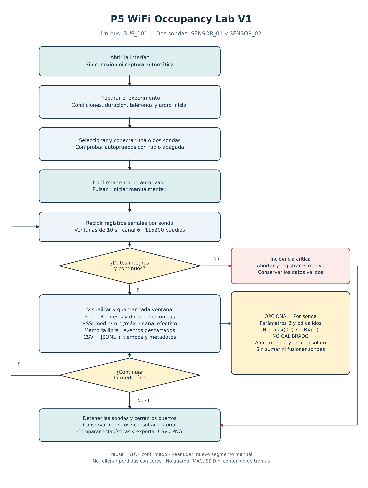

# Interfaz P5 WiFi Occupancy Lab V1

Figura: flujo implementado para una o dos sondas del mismo BUS_001. La rama de
estimación es opcional y no combina sus resultados. Es un esquema funcional,
no evidencia de una nueva prueba de campo.

## Texto para el informe

La interfaz de escritorio P5 WiFi Occupancy Lab V1 permite organizar y supervisar experimentos de observación WiFi mediante una o dos sondas ESP32 ubicadas en el mismo bus, identificado como BUS_001. Cada placa se distingue como SENSOR_01 o SENSOR_02 y conserva una lectura serial independiente a 115200 baudios. Antes de medir, el operador selecciona los puertos, comprueba las autopruebas y documenta la duración, ubicación, cantidad de teléfonos, distancia y condiciones de uso. La captura requiere confirmación de un entorno autorizado e inicio manual. Durante la adquisición se muestran, por ventanas de diez segundos, las solicitudes Probe Request recibidas, las direcciones únicas, el RSSI promedio, mínimo y máximo, el canal efectivo, la memoria libre y los eventos descartados. Las gráficas permiten observar y comparar ambas sondas por separado. Además, el operador puede actualizar el aforo manual y añadir observaciones, registrando el instante de cada cambio como referencia para el análisis experimental posterior.

La aplicación verifica la integridad de los registros JSON y detecta corrupción serial, ventanas faltantes, duplicados, reinicios y desconexiones. Ante una incidencia crítica, interrumpe la medición, conserva los datos válidos y cierra los puertos; las pausas intencionales se registran separadamente y los datos ausentes no se sustituyen por ceros. Cada observación conserva el tiempo del ESP32 y la recepción del computador, cuyo reloj monotónico sirve para comparar las sondas sin suponer sincronización exacta. Los resultados se almacenan automáticamente en CSV, JSONL y metadatos, y pueden consultarse mediante el historial y exportarse como gráficas. Opcionalmente, se calcula N = max(0, (D − B)/pd), con parámetros independientes por sonda y la advertencia permanente NO CALIBRADO. La estimación se contrasta con el aforo manual disponible mediante el error absoluto. Las direcciones únicas no equivalen a pasajeros ni se suman entre sondas o ventanas; tampoco se almacenan MAC originales, SSID o contenido de las tramas.

## Trazabilidad

Descripción basada en `captura/MANUAL_LABORATORIO.md` y los módulos `app.py`,
`controller.py`, `transport.py`, `protocol.py`, `storage.py`, `history.py`,
`model.py` e `identity.py` de `captura/p5_lab/`. No afirma calibración ni validación
física simultánea de la interfaz. Los registros conservan el ID serial heredado
en `sensor_id`; `probe_id` distingue las sondas y `bus_id` identifica el bus común.

Imagen exportable: `diagramas/flujo_interfaz_p5.png` (300 ppp).
Versión vectorial: `diagramas/flujo_interfaz_p5.svg`.
Fuente reproducible: `diagramas/generar_flujo_interfaz.py`.
